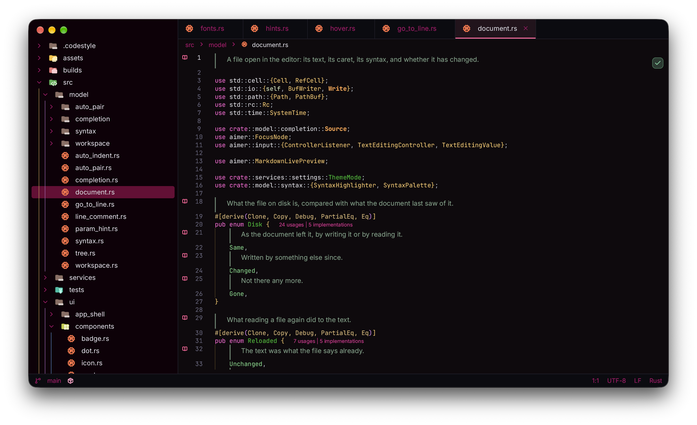

# Refractor

A code editor built with the  [Aimer](https://github.com/aimer-rs/aimer) framework. It's only contains the editor essential for Aimer's developers daily use. 

## Features

- Editor essential like editor, syntax highlight, lsp, navigation....
- Slim no any bloated feature
- Some shortcuts that enough for daily using
- Search everywhere
- Markdown viewer and document command rendering
- No Extensions plugin....
- No any builtin AI 
- Just a pure editor

## Who need it ?

- A developer who want a editor with minimal design
- Polished and optimize for human coding
- Need an editor that no any builtin AI tool
- Smooth coding experience with low latency
- Someone need the light and fancy code editor

## Who is using right now ?

[Aimer](https://github.com/aimer-rs/aimer) developer teams is using it for build the Aimer UI framework.

## Screenshots

